<div align="center">


<br>
<br>


<br>
<br>

**Controle de caixa pessoal e profissional para microempreendedores.**<br>
Saldo, contas a pagar e a receber, crédito parcelado e relatórios — no celular e no computador.

<br>

<a href="https://monerpy.vercel.app/ghost-test-user"></a>

<sub>Entra como <b>visitante</b>, com dados de exemplo: sem cadastro e nada é salvo.</sub>

<br>
<br>

[Funcionalidades](#funcionalidades)
&nbsp;·&nbsp; [Telas](#telas)
&nbsp;·&nbsp; [Como funciona](#como-funciona)
&nbsp;·&nbsp; [Tecnologias](#tecnologias)
&nbsp;·&nbsp; [Rodando localmente](#rodando-localmente)
&nbsp;·&nbsp; [Histórico de versões](CHANGELOG.md)

</div>

<br>

## Sobre o Monerpy

Quem presta serviço costuma misturar o dinheiro do trabalho com o de casa, esquecer boletos e só descobrir no fim do mês para onde o dinheiro foi.

O **Monerpy** resolve isso com um app simples, pensado primeiro para o celular. Ele mostra o **saldo total disponível**, separa o que é **Profissional** do que é **Pessoal**, avisa quais contas estão **atrasadas** e lembra o que vence nos próximos dias. Para dar baixa numa conta, basta um toque.

<p align="center">
  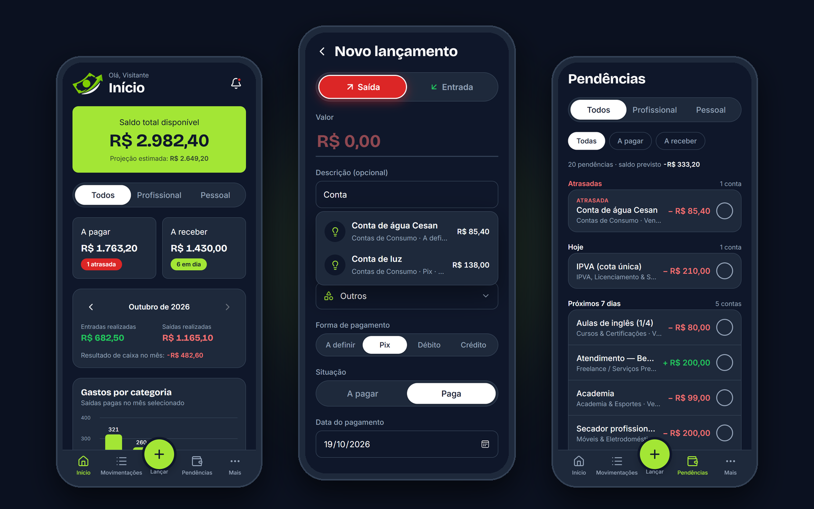
</p>

> [!TIP]
> O botão **Faça um teste agora** abre o app de verdade no **modo visitante** ([monerpy.vercel.app/ghost-test-user](https://monerpy.vercel.app/ghost-test-user)). Tudo roda na memória do navegador: dá para lançar, dar baixa e mexer à vontade, e atualizar a página restaura o exemplo.

## Para quem é

- **Autônomos e MEIs** que recebem por serviço, como cabeleireiras, designers, fotógrafos, eletricistas e professores particulares.
- **Pequenos negócios de serviço** que precisam saber, em segundos, quanto têm para pagar e para receber.
- **Quem usa a mesma conta para tudo** e quer separar o profissional do pessoal sem abrir duas contas.

## Funcionalidades

| | O que faz | Onde fica |
|---|---|---|
| **Saldo total disponível** | Saldo atual em destaque, com a projeção depois das pendências. Fica vermelho se ficar negativo. | Início |
| **Profissional e Pessoal** | Um seletor filtra indicadores, pendências e listas entre o trabalho e a casa. | Início, Movimentações e Pendências |
| **A pagar e A receber** | Soma o que está pendente, com selos como **1 atrasada** ou **6 em dia**. | Início e Pendências |
| **Novo lançamento** | Entrada ou saída com valor, descrição, contexto, categoria (50 opções com ícones), forma de pagamento e situação. | Botão **+** |
| **Sugestões pelo histórico** | Ao digitar "Conta", o app sugere a *Conta de água* do mês passado; um toque repete valor, categoria e forma de pagamento. | Novo lançamento |
| **Aviso de saldo zerado** | Antes de salvar uma saída que zera o saldo, mostra saldo, despesa e saldo previsto e pede confirmação. | Novo lançamento |
| **Crédito parcelado e fixo** | Parcela ou repete com periodicidade (semanal, mensal, anual…) ou cria uma cobrança **fixa mensal** sem fim. | Novo lançamento → Crédito |
| **Dar baixa com um toque** | Marca como paga ou recebida; dá para desfazer, cancelar e restaurar. | Pendências |
| **Histórico** | Movimentações agrupadas por dia, com busca e filtros por tipo, contexto, categoria e período. | Movimentações |
| **Lembretes** | Vencimentos próximos e atrasados, com contador no sino. | Lembretes |
| **Relatórios e CSV** | Entradas x saídas, gastos por categoria, previsão e exportação para planilha. | Relatórios e Exportar CSV |
| **Registro com aprovação** | Quem quer usar pede acesso; um administrador aprova ou recusa e o app envia o e-mail. | Registros |
| **Excluir minha conta** | Confirmação em duas etapas (caixa + digitar CONFIRMAR) e exclusão de todos os dados. | Configurações |
| **Modo escuro e claro** | O escuro é o padrão; o claro pode ser escolhido a qualquer momento. | Configurações |

## Veja em ação

<table>
<tr>
<td align="center" width="50%">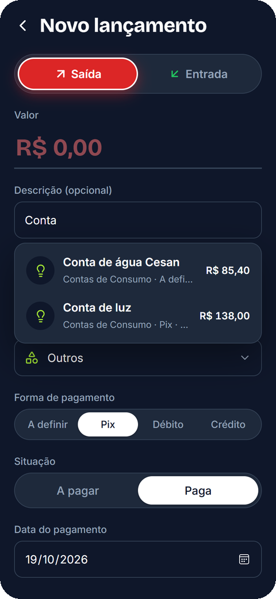</td>
<td align="center" width="50%">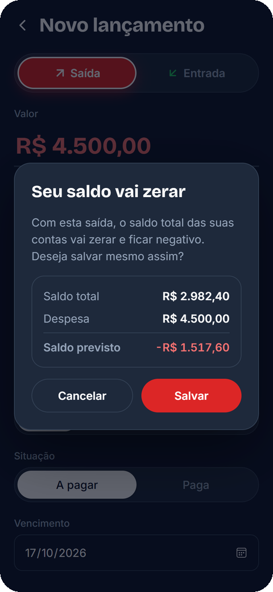</td>
</tr>
<tr>
<td align="center"><b>Sugestões pelo histórico</b><br><sub>Digite o começo do nome e repita um lançamento anterior</sub></td>
<td align="center"><b>Aviso de saldo zerado</b><br><sub>Negativos em vermelho; Cancelar volta ao formulário</sub></td>
</tr>
</table>

## Telas

<table>
<tr>
<td align="center" width="33%">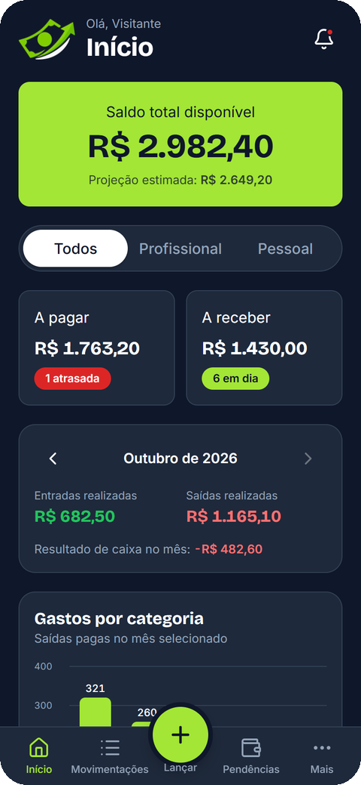<br><b>Início</b><br><sub>Saldo, pendências e resumo do mês</sub></td>
<td align="center" width="33%">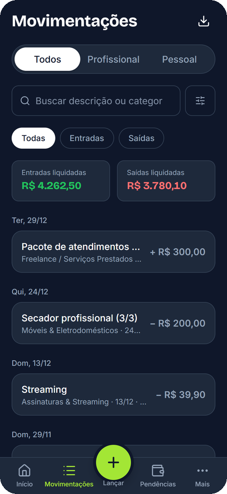<br><b>Movimentações</b><br><sub>Histórico agrupado por dia</sub></td>
<td align="center" width="33%">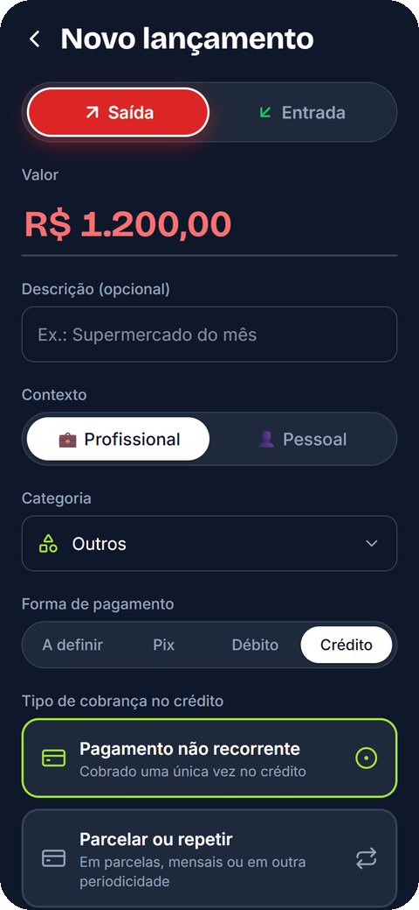<br><b>Novo lançamento</b><br><sub>Crédito único, parcelado ou fixo</sub></td>
</tr>
<tr>
<td align="center">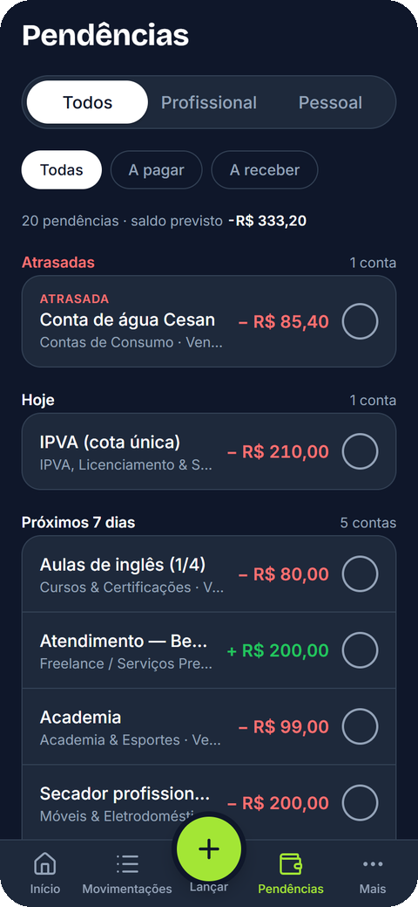<br><b>Pendências</b><br><sub>Atrasadas, hoje e próximos dias</sub></td>
<td align="center">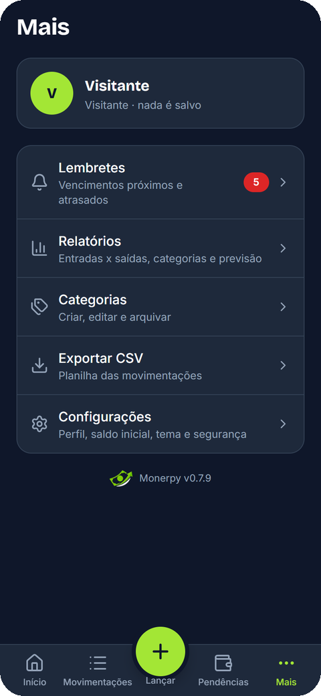<br><b>Mais</b><br><sub>Lembretes, relatórios e ajustes</sub></td>
<td align="center">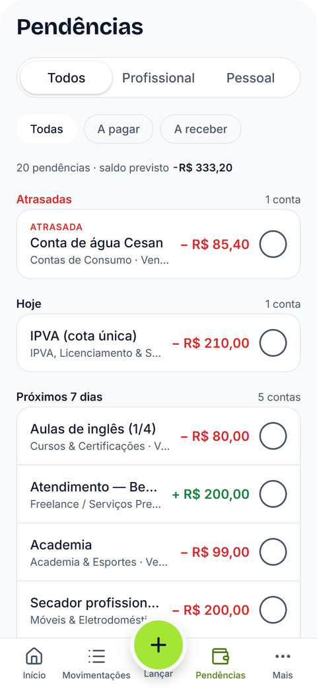<br><b>Modo claro</b><br><sub>As mesmas telas, fundo claro</sub></td>
</tr>
</table>

### No computador

A partir de 1024 px, a barra inferior vira uma barra lateral e o Início ganha colunas.

<p align="center">
  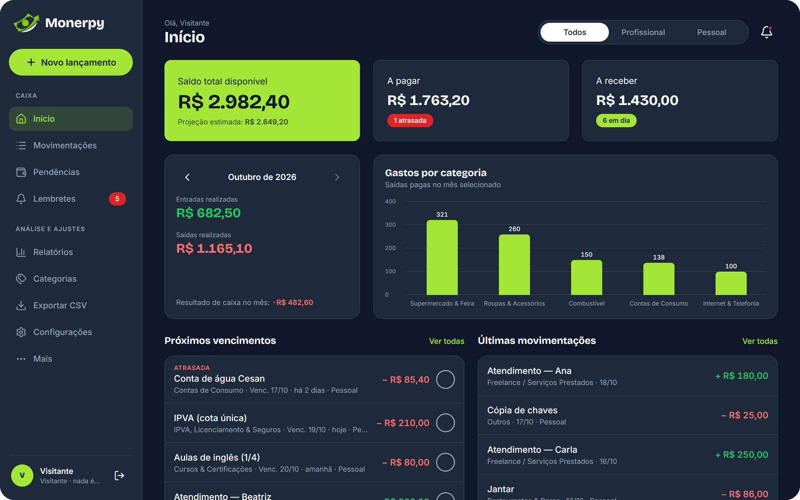
</p>

<details>
<summary><b>Ver o computador no modo claro</b></summary>
<br>
<p align="center">
  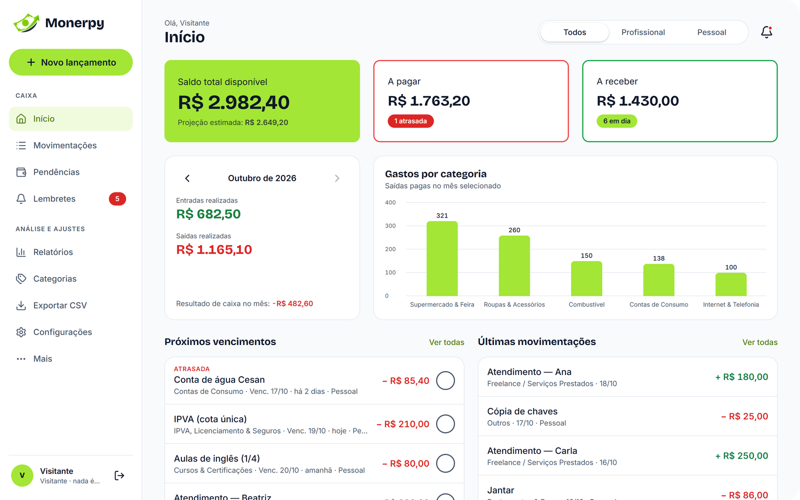
</p>
</details>

## Como funciona

Todo lançamento nasce **pago/recebido** (vai direto para as movimentações) ou **pendente** (vai para Pendências até você dar baixa).

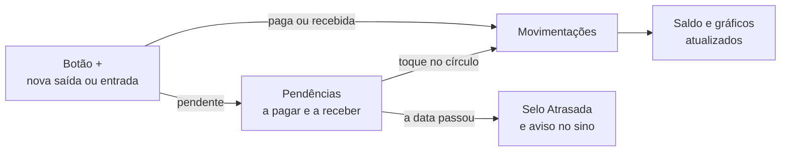

**Exemplo prático**

> Hoje é dia 15/10. Você lança a *Conta de água*, de **R$ 85,40**, com vencimento em **17/10**.
>
> - Até o dia 17, ela aparece em **Próximos 7 dias**, e o card **A pagar** do Início sobe R$ 85,40.
> - Se o dia 17 passar sem pagamento, ela ganha o selo **ATRASADA** e o sino ganha um ponto vermelho.
> - Quando você paga e toca no círculo, ela vai para **Movimentações** e o **saldo total** cai R$ 85,40.
> - No mês seguinte, ao digitar "Conta", o app sugere repetir o mesmo lançamento.

<details>
<summary><b>Termos usados no app</b> (toque para abrir)</summary>
<br>

| Termo | O que significa |
|---|---|
| **Saída** | Dinheiro que sai: uma despesa, um boleto, um pagamento. |
| **Entrada** | Dinheiro que entra: um serviço que o cliente pagou ou vai pagar. |
| **Dar baixa** | Avisar ao app que a conta já foi paga ou recebida. |
| **Contexto** | Se o lançamento é do trabalho (Profissional) ou de casa (Pessoal). |
| **A definir** | Forma de pagamento ainda não escolhida; o lançamento fica pendente. |
| **Atrasada** | Pendente com data anterior a hoje. |
| **Projeção estimada** | Saldo total depois de receber e pagar todas as pendências. |

</details>

## Escuro e claro

<p align="center">
  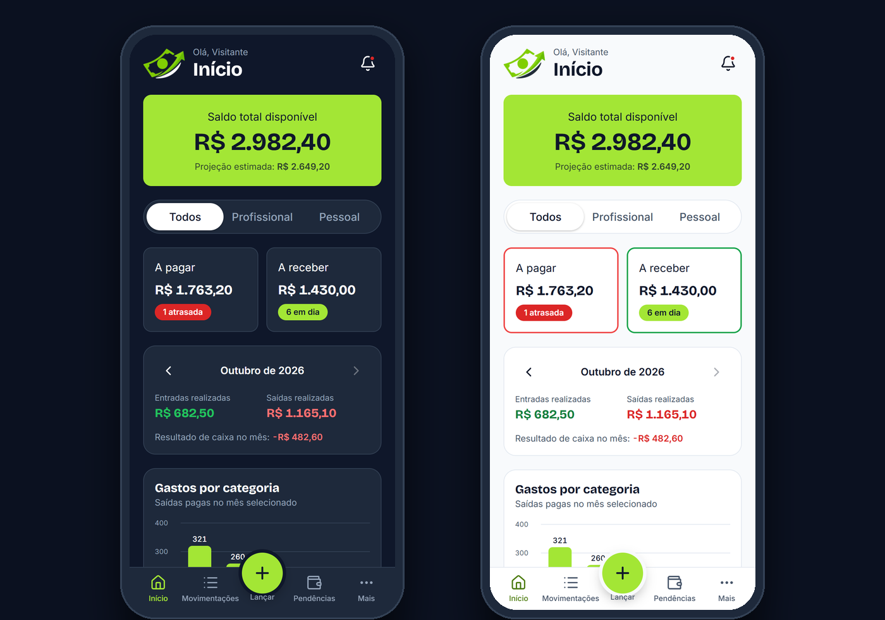
</p>

O **modo escuro** é o padrão: cansa menos a vista e destaca o verde-lima das ações. O **modo claro** fica em **Configurações › Aparência**, e a logo, o ícone da aba e as cores se adaptam ao tema.

## Design system

O "manual de estilo" do app: as cores, as letras e as medidas que todas as telas seguem.

### Cores (modo escuro)

| | Nome | Código | Onde é usada |
|:-:|---|---|---|
|  | Verde-lima | `#A3E635` | Botões, destaques e ações principais |
|  | Preto-rico | `#0F172A` | Fundo das telas |
|  | Ardósia escura | `#1E293B` | Cards, campos e barra de navegação |
|  | Borda | `#334155` | Linhas e contornos |
|  | Branco | `#FFFFFF` | Textos principais |
|  | Cinza-azulado | `#94A3B8` | Textos secundários e legendas |
|  | Verde | `#22C55E` | Entradas, valores positivos e sucesso |
|  | Vermelho | `#EF4444` | Saídas, atrasos, negativos e alertas |

<details>
<summary><b>Cores do modo claro</b></summary>
<br>

| | Nome | Código | Onde é usada |
|:-:|---|---|---|
|  | Branco | `#FFFFFF` | Cards |
|  | Gelo | `#F8FAFC` | Fundo das telas |
|  | Cinza-claro | `#F1F5F9` | Campos e elementos |
|  | Borda clara | `#E2E8F0` | Linhas e itens desativados |
|  | Azul-escuro | `#0F172A` | Títulos e textos principais |
|  | Cinza | `#475569` | Textos secundários |
|  | Verde-lima | `#A3E635` | Botões e ações |
|  | Verde | `#16A34A` | Entradas e recebidos |
|  | Vermelho | `#EF4444` | Saídas e alertas |

</details>

**Regra de ouro:** verde-lima é para **agir**, verde é dinheiro que **entra** e vermelho é dinheiro que **sai**, está **atrasado** ou **negativo**.

### Tipografia

| Uso | Fonte | Exemplo |
|---|---|---|
| Títulos e valores | **Bricolage Grotesque**, negrito | Início · R$ 2.982,40 |
| Textos e botões | **Inter**, normal, médio e seminegrito | Saldo total disponível · Confirmar |

## Tecnologias

| Camada | O que usamos |
|---|---|
| Interface | **Next.js 15** (App Router) · **React 19** · **TypeScript** · **Tailwind CSS 4** · Lucide (ícones) |
| Formulários e regras | **Zod** (validação) · React Hook Form · regras financeiras puras em `src/lib/domain` |
| Dados e login | **Supabase**: Auth + PostgreSQL com **RLS** (cada pessoa só enxerga os próprios dados) |
| E-mails | Nodemailer via SMTP (aprovação e recusa de registro) |
| Qualidade | **Vitest** (43 testes das regras de dinheiro, datas, parcelas e sugestões) · ESLint |
| Hospedagem | **Vercel** (deploy automático a cada push na `main`) |

Decisões importantes:

- Dinheiro é manipulado em **centavos inteiros** no app e `NUMERIC(14,2)` no banco: nunca `float`.
- O **saldo total** é único (não há contas/carteiras). O filtro Profissional/Pessoal afeta indicadores, pendências e listas.
- Lançamentos são **cancelados**, não apagados (o banco revoga `DELETE` em `transactions`).
- Criar lançamentos e parcelas é **idempotente** (id gerado no cliente): clique duplo não duplica.

## Estrutura do projeto

```text
src/
  app/                  rotas (App Router). (app)/ = área logada; api/ = rotas do servidor
  components/
    ui/                 peças visuais do Design System (Sheet, Field, Logo…)
    layout/             barra lateral (computador), barra inferior (celular)
    transactions/       formulário, sugestões, linhas, baixa, pendências
    charts/             gráficos em CSS
  providers/            estado global: dados (DataProvider) e avisos (ToastProvider)
  lib/
    domain/             regras de negócio puras + testes (saldo, parcelas, sugestões, CSV…)
    data/               acesso a dados: LocalRepo (navegador/visitante) e SupabaseRepo
    server/             SÓ servidor: cliente admin (service_role), SMTP, guardas de login
  middleware.ts         protege as rotas quando o Supabase está configurado
supabase/migrations/    esquema SQL versionado com RLS
docs/                   arquitetura, imagens e selos deste README
```

Detalhes em [`docs/ARQUITETURA.md`](docs/ARQUITETURA.md). Para contribuir (branches, commits, versões), veja [`CONTRIBUTING.md`](CONTRIBUTING.md).

## Rodando localmente

```bash
npm install
npm run dev      # http://localhost:3000
npm test         # regras financeiras (critérios de aceite do PRD)
npm run check    # tipos + lint + testes (rode antes de cada commit)
npm run build
```

> [!NOTE]
> Sem `.env.local` o app roda em **modo local**: os dados ficam no `localStorage` do navegador. Serve para desenvolver e demonstrar (há a opção "Explorar com dados de exemplo").

<details>
<summary><b>Conectando o Supabase</b></summary>
<br>

1. No [painel do Supabase](https://supabase.com/dashboard), crie um projeto (região São Paulo, `sa-east-1`).
2. **Banco:** rode as migrations (tabela abaixo) no *SQL Editor*.
3. **Usuária:** em *Authentication → Users → Add user*, crie o usuário (e-mail + senha, marque *Auto Confirm*). Desative cadastros públicos em *Authentication → Sign In / Providers → Allow new users to sign up*: o acesso é por [registro com aprovação](#registro-com-aprovação-do-administrador).
4. **URLs:** em *Authentication → URL Configuration*, defina *Site URL* e adicione `<site>/redefinir-senha` e `<site>/definir-senha` em *Redirect URLs*.
5. **Chaves:** copie `.env.example` para `.env.local` e preencha com *Project URL* e a chave **anon/publishable** (*Project Settings → API*). Nunca use a chave `service_role` no frontend.
6. Reinicie `npm run dev`. A tela de login passa a pedir e-mail e senha.

</details>

<details>
<summary><b>Migrations do banco</b></summary>
<br>

Rode cada arquivo de `supabase/migrations/`, em ordem, no **SQL Editor** do Supabase (uma vez cada):

| Arquivo | Versão | O que faz |
|---|---|---|
| `20261015000000_init.sql` | 0.1 | Tabelas, RLS, categorias iniciais, parcelamento |
| `20261016000000_registration_requests.sql` | 0.4 | Pedidos de registro e administradores |
| `20261017000000_credit_groups_and_categories.sql` | 0.6 | Crédito: parcelar/repetir com periodicidade e fixa mensal; nova lista de categorias |
| `20261018000000_outros_category.sql` | 0.7.1 | Categoria "Outros" (Entrada e Saída) para todas as contas |

</details>

<details>
<summary><b>Registro com aprovação do administrador</b></summary>
<br>

Novas usuárias tocam em **Registrar**, informam o e-mail e o pedido fica pendente. Um administrador aprova ou recusa em **Registros** (barra lateral / Mais). Aprovado: a pessoa recebe um link para criar a senha. Recusado: recebe um e-mail de recusa, com motivo opcional.

1. Rode `20261016000000_registration_requests.sql` no **SQL Editor**.
2. Torne sua conta administradora (troque o e-mail) e rode no SQL Editor:
   ```sql
   update public.profiles set is_admin = true
   where user_id = (select id from auth.users where email = 'seu-email@exemplo.com');
   ```
3. **Vercel → Environment Variables:** `SUPABASE_SERVICE_ROLE_KEY` (Supabase → API Keys → *service_role / secret*), marcada como **Sensitive** e **sem** prefixo `NEXT_PUBLIC_`. Opcional: `ADMIN_EMAIL` (aviso de novos pedidos), `APP_URL` (URL pública para os links) e `SUPPORT_EMAIL` (contato exibido a e-mails recusados).
4. Configure o SMTP (abaixo) e faça **Redeploy**.

Regras: um e-mail **recusado não pode pedir acesso de novo** e um e-mail já aprovado é orientado a entrar. Em **Recusados**, o botão **Aprovar cadastro** move o pedido para Aprovados. Quem **exclui a conta** pode pedir acesso de novo. A mesma chave `service_role` é usada pela rota de exclusão de conta.

</details>

<details>
<summary><b>Configurar SMTP (e-mails sem limite de 2 por hora)</b></summary>
<br>

O e-mail padrão do Supabase envia **no máximo 2 e-mails de autenticação por hora para o projeto inteiro**. Com um SMTP próprio esse limite passa a ser configurável. O mesmo SMTP é usado pelo app nos e-mails de aprovação/recusa.

**Exemplo com Gmail** (até ~500 e-mails/dia):
1. Ative a verificação em duas etapas na conta Google e crie uma **senha de app** em <https://myaccount.google.com/apppasswords>.
2. **Supabase → Authentication → Emails → SMTP Settings:** host `smtp.gmail.com`, porta `465`, usuário = seu Gmail, senha = senha de app, remetente = seu Gmail, nome = `Monerpy`.
3. **Supabase → Authentication → Rate Limits:** aumente *Rate limit for sending emails* (ex.: 30 por hora).
4. **Vercel → Environment Variables:** `SMTP_HOST`, `SMTP_PORT`, `SMTP_USER`, `SMTP_PASS` (Sensitive) e `SMTP_FROM`; depois, Redeploy.

Outras opções: Brevo (`smtp-relay.brevo.com`, porta `587`) ou Resend (exige domínio próprio).

</details>

<details>
<summary><b>Usuário visitante e marca</b></summary>
<br>

- **Visitante:** `/ghost-test-user` abre o app com dados de exemplo que mostram todas as funcionalidades, na memória do navegador. Ao criar uma funcionalidade nova, inclua um exemplo dela em `buildDemoData` (`src/lib/data/seed.ts`).
- **Marca:** logo e ícones são gerados a partir dos SVGs em `design/brand/` com `python scripts/brand/gerar_marca.py` (requer Pillow e Microsoft Edge). Ao trocar a arte, aumente `ICON_VERSION` em `src/lib/brandIcons.ts`.

</details>

## Próximos passos

- [x] Design system, protótipo navegável e versão para celular
- [x] Login, dados salvos no Supabase e registro com aprovação
- [x] Versão para computador (barra lateral e colunas)
- [x] Categorias, crédito parcelado, repetido e fixo mensal
- [x] Lembretes, relatórios e exportação CSV
- [x] Sugestões pelo histórico, aviso de saldo e exclusão de conta
- [ ] Lembretes por e-mail, WhatsApp ou notificação
- [ ] Instalar como app (PWA com uso offline)
- [ ] Anexar comprovantes aos lançamentos

<br>

<div align="center">


<sub><b>Monerpy</b> · O controle financeiro na sua mão</sub>

<br>

<a href="https://monerpy.vercel.app/ghost-test-user"><b>Faça um teste agora →</b></a>
</div>
